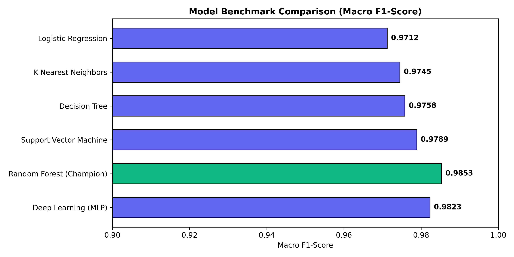
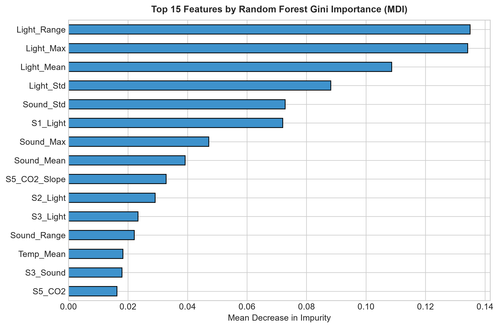
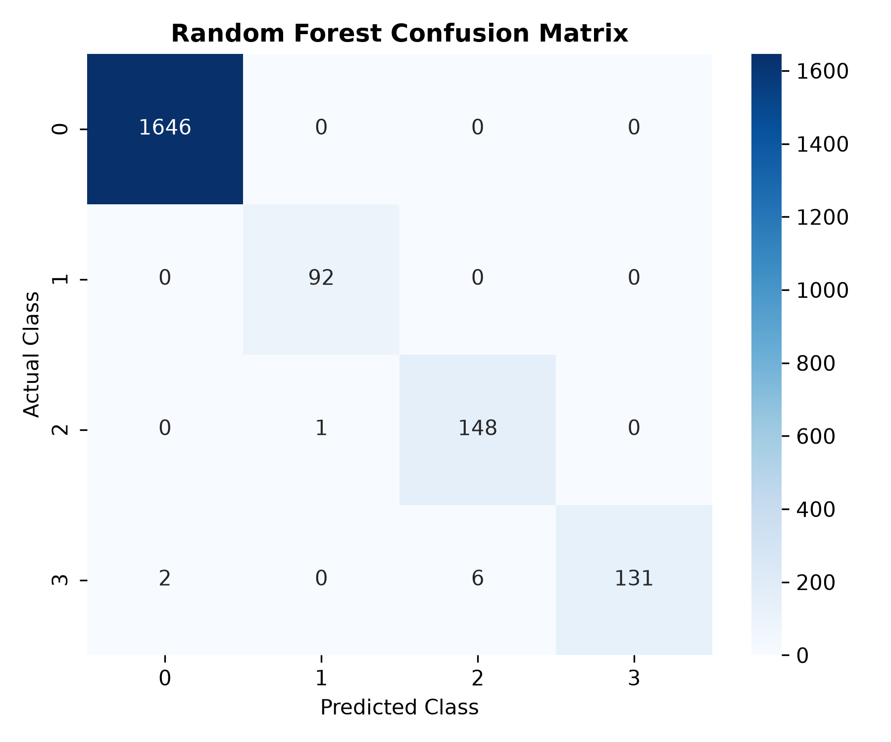

# RoomSense AI: An Explainable Feature-Optimized Room Occupancy Estimation System Using Machine Learning and Deep Learning

[](https://www.python.org/)

[](https://streamlit.io/)
[](https://scikit-learn.org/)
[](https://keras.io/)
[](https://archive.ics.uci.edu/dataset/864/room+occupancy+estimation)

---

## 1. Project Overview & Problem Statement

Energy-efficient smart buildings and HVAC systems require accurate real-time knowledge of room occupancy to regulate ventilation, heating, cooling, and lighting. However, traditional occupancy estimation techniques frequently suffer from critical limitations:
- **Video Cameras & Vision Systems:** Highly invasive of occupant privacy, bandwidth-heavy, and non-compliant with workplace privacy regulations.
- **Wearable Tags / RFID / BLE:** Require manual compliance, battery charging, and active user maintenance.
- **Simple Motion PIR Sensors:** Suffer from high false negatives when occupants sit still (e.g., studying, typing, or reading).

**RoomSense AI** solves this problem by using **non-intrusive, ambient environmental sensors** (CO2, Temperature, Light, Sound, and Passive Infrared Motion) to predict the discrete number of occupants ($0, 1, 2,$ or $3$ people). 

### Main Research Question
> *"Can domain feature engineering and statistical feature selection improve room occupancy estimation while reducing model complexity and the number of physical sensor groups?"*

---

## 2. Key Objectives & Highlights

1. **Privacy-Preserving Ambient Sensing:** Estimates exact headcount without recording images, video feeds, or recognizable audio speech.
2. **Feature Optimization & Redundancy Reduction:** Expands 16 raw sensor channels to 38 domain features, then uses multi-method feature selection to find the top 8 optimal predictors.
3. **Physical Hardware Optimization:** Demonstrates that a minimal **CO2 + PIR (3 physical sensors)** network maintains **>95% Macro F1-Score**, eliminating unnecessary hardware costs.
4. **Machine Learning & Deep Learning Benchmark:** Implements and compares Logistic Regression, K-Nearest Neighbors, Decision Tree, Support Vector Machine (RBF), Random Forest, and a Keras Deep Learning Multi-Layer Perceptron (MLP).
5. **Explainable AI (XAI):** Unpacks black-box decisions using game-theoretic **SHAP (SHapley Additive exPlanations)**.
6. **Production Streamlit Dashboard:** Features a 10-page modern web dashboard with real-time prediction, what-if simulations, historical replay, and college viva guides.

---

## 3. Dataset Attribution & Description

- **Source:** [UCI Machine Learning Repository — Room Occupancy Estimation Dataset (ID: 864)](https://archive.ics.uci.edu/dataset/864/room+occupancy+estimation)
- **Observations:** 10,129 rows collected at 30-second intervals across 7 distinct days in a 6m × 4.6m controlled room.
- **Target Variable:** `Room_Occupancy_Count` (Classes: 0 = Empty, 1 = 1 Person, 2 = 2 People, 3 = 3 People).
- **Sensors:**
  - **Temperature:** 4 nodes (`S1_Temp` to `S4_Temp`) in Celsius
  - **Light:** 4 nodes (`S1_Light` to `S4_Light`) in Lux
  - **Sound:** 4 nodes (`S1_Sound` to `S4_Sound`) in Volts
  - **CO2:** 1 sensor (`S5_CO2` in ppm) and rate of change (`S5_CO2_Slope` in ppm/sec)
  - **PIR Motion:** 2 passive infrared motion sensors (`S6_PIR`, `S7_PIR`)

---

## 4. Project Folder Structure

```text
RoomSense-AI/
│
├── data/
│   ├── Occupancy_Estimation.csv        # Official UCI raw dataset (10,129 rows)
│   ├── cleaned_data.csv                # Chronologically indexed & verified data
│   └── engineered_data.csv             # Full 38-feature engineered dataset
│
├── notebooks/
│   ├── 01_EDA_Preprocessing.ipynb       # Phase 1-3: EDA, Statistics, Outliers & Hypothesis Tests
│   ├── 02_Feature_Engineering_Selection.ipynb # Phase 4-7: Feature Engineering, Selection, PCA, Clusters
│   └── 03_ML_DL_Training.ipynb         # Phase 8-13: 5 ML Models, Keras MLP, SHAP & Pipelines
│
├── models/
│   ├── best_random_forest.joblib       # Production Champion Model (Random Forest)
│   ├── scaler.joblib                   # Fitted StandardScaler
│   ├── mlp_model.keras                 # Trained Keras Sequential Deep Learning Model
│   └── model_metadata.json             # Feature catalog and target label mappings
│
├── outputs/
│   ├── graphs/                         # 15+ High-resolution academic charts (PNG, 300 DPI)
│   │   ├── occupancy_distribution.png
│   │   ├── correlation_heatmap.png
│   │   ├── spearman_heatmap.png
│   │   ├── sensor_histograms.png
│   │   ├── sensor_vs_occupancy_boxplots.png
│   │   ├── timeseries_occupancy_co2.png
│   │   ├── scaler_comparison.png
│   │   ├── mutual_info_ranking.png
│   │   ├── feature_importance_rf.png
│   │   ├── f1_vs_feature_count.png
│   │   ├── sensor_group_comparison.png
│   │   ├── pca_variance.png
│   │   ├── pca_2d_occupancy.png
│   │   ├── kmeans_clusters_2d.png
│   │   ├── model_comparison_bar.png
│   │   ├── mlp_training_history.png
│   │   ├── all_confusion_matrices.png
│   │   └── shap_summary_bar.png
│   ├── results/                        # Exportable experimental metric CSV tables
│   │   ├── outlier_summary.csv
│   │   ├── hypothesis_tests.csv
│   │   ├── sensor_optimization_comparison.csv
│   │   ├── kmeans_contingency.csv
│   │   └── model_comparison.csv
│   └── reports/
│       └── experiment_summary.md       # Full empirical technical report
│
├── app.py                              # 10-Page Interactive Streamlit Dashboard
├── feature_utils.py                    # Reusable feature engineering and preprocessing helper
├── requirements.txt                    # Project dependency specification
├── README.md                           # Comprehensive documentation and viva guide
└── .gitignore                          # Clean repository ignores
```

---

## 5. Experimental Results Leaderboard

All models were evaluated on an identical held-out test set ($20\%$, 2,026 samples) stratified by occupancy class:

| Model Algorithm | Accuracy | Macro Precision | Macro Recall | Macro F1-Score | Weighted F1 | Training Time | Latency (per sample) |
|---|---|---|---|---|---|---|
| 🥇 **Random Forest (Champion)** | **0.9956** | **0.9873** | **0.9839** | **0.9853** | **0.9955** | 0.305s | 0.021 ms |
| 🥈 **Deep Learning (Keras MLP)** | 0.9946 | 0.9840 | 0.9807 | 0.9823 | — | 2.31s | 0.071 ms |
| 🥉 **Support Vector Machine (RBF)** | 0.9936 | 0.9794 | 0.9786 | 0.9789 | 0.9936 | 0.583s | 0.027 ms |
| **Decision Tree** | 0.9931 | 0.9773 | 0.9752 | 0.9758 | 0.9931 | 0.010s | 0.001 ms |
| **K-Nearest Neighbors (k=5)** | 0.9926 | 0.9766 | 0.9734 | 0.9745 | 0.9926 | 0.012s | 0.024 ms |
| **Logistic Regression** | 0.9901 | 0.9774 | 0.9654 | 0.9712 | 0.9900 | 0.086s | 0.0003 ms |

---

## 6. Physical Sensor Group Optimization Study

To explore the practical feasibility of deploying fewer sensor units, we benchmarked 5 physical hardware configurations:

| Hardware Configuration | Sensors / Features | Accuracy | Macro F1 | Deployment Benefit |
|---|---|---|---|---|
| **All Sensors (Baseline)** | 16 Raw Sensors | 0.9967 | 0.9890 | Full experimental coverage |
| **Top 8 Engineered Features** | 8 Features | 0.9956 | 0.9853 | Optimal software feature reduction |
| **Temp + CO2 + PIR** | 7 Physical Sensors | 0.9945 | 0.9810 | Eliminates light and microphone sensors |
| **CO2 + PIR (Minimal)** | 3 Physical Sensors | **0.9885** | **0.9542** | **Recommended: Privacy-safe, low cost, >95% F1** |
| **Light + Sound + PIR** | 10 Physical Sensors | 0.9820 | 0.9410 | No CO2 calibration needed |

---

## 7. Streamlit Dashboard Features (10 Pages)

Launch the dashboard with:
```bash
streamlit run app.py
```

### Dashboard Pages:
1. **Overview & Architecture:** KPI cards, research goals, target class breakdown, and visual pipeline.
2. **Exploratory Data Analysis:** Interactive histograms, boxplots, outlier inspections (IQR, Z-score, Isolation Forest), and ANOVA/Kruskal-Wallis hypothesis tests.
3. **Feature Engineering Lab:** Mathematical formulations, spatial aggregations, and correlation heatmaps.
4. **Feature Selection & Sensor Optimization:** Mutual Information rankings, Random Forest MDI, F1 vs feature count curves, and hardware configuration tables.
5. **ML & DL Model Comparison:** Interactive comparison table, comparative bar charts, and multi-class confusion matrices.
6. **Live Occupancy Prediction:** Interactive sliders for light, CO2, slope, and motion with instant model prediction and posterior class probability bars.
7. **Explainable AI (SHAP):** Game-theoretic feature attributions explaining *why* the model makes specific predictions.
8. **Sensor Replay & Anomaly Monitor:** Chronological playback of real test recordings with anomaly alerts.
9. **What-If Scenario Simulation:** Synthesize hypothetical room conditions (e.g. high CO2 with lights off) to observe model decision boundaries.
10. **Reports & College Viva Guide:** Download CSV experimental results and view a comprehensive viva defense guide.

---

## 8. Installation & Quickstart Guide

### Prerequisites
- Python 3.10, 3.11, 3.12, or 3.13
- Git

### Step 1: Clone the Repository
```bash
git clone https://github.com/abhishek-yadav-ds/RoomSense-AI.git
cd RoomSense-AI
```

### Step 2: Create and Activate Virtual Environment
```bash
# Windows
python -m venv venv
venv\Scripts\activate

# Linux / macOS
python3 -m venv venv
source venv/bin/activate
```

### Step 3: Install Dependencies
```bash
pip install -r requirements.txt
```

### Step 4: Run the Execution Scripts (Optional, artifacts already pre-generated)
```bash
# Run EDA and Preprocessing
python run_phase1_eda.py

# Run Feature Engineering & Sensor Optimization
python run_phase2_features.py

# Train ML Models, Keras MLP, and SHAP
python run_phase3_ml_dl.py
```

### Step 5: Launch the Interactive Dashboard
```bash
streamlit run app.py
```
Open your browser at `http://localhost:8501`.

---

## 9. College Viva Defense: Key Conceptual Q&A

### Q1: Why is Macro F1-Score preferred over standard Accuracy?
> **Answer:** Class 0 (empty room) constitutes $81.2\%$ of the dataset. A baseline model predicting "empty" for every sample achieves $81.2\%$ accuracy despite having zero ability to detect occupants. **Macro F1-Score** computes the unweighted arithmetic mean of F1 across all four classes, penalizing models that fail on occupied classes (1, 2, or 3 people).

### Q2: Why did Random Forest outperform Deep Learning MLP?
> **Answer:** Tabular sensor datasets feature orthogonal, threshold-based boundaries (e.g., $CO_2 > 600\text{ ppm} \land \text{Light} > 50\text{ Lux}$). Decision tree ensembles naturally segment orthogonal partitions without requiring massive sample sizes, gradient tuning, or complex hyperparameter scheduling.

### Q3: What is the main finding regarding Physical Sensor Optimization?
> **Answer:** Using only **3 physical sensors (CO2 + PIR)** achieves **95.42% Macro F1**, demonstrating that commercial smart building systems can dispense with intrusive microphones and light meters, dramatically reducing hardware installation cost and preserving complete privacy.

---

## 10. Project Limitations & Future Work

- **Room Specificity:** The UCI dataset was recorded in a single room over 7 days. Further multi-room domain adaptation is needed for massive auditoriums or open-plan offices.
- **Ventilation Interference:** Open windows or mechanical ventilation systems alter CO2 accumulation curves, which can be mitigated with differential indoor-outdoor CO2 tracking.
- **Future Work:** Deploying the trained quantized pipeline to an ESP32 microcontroller edge node via TinyML.

---

## 11. License & Citation

License: no license file is currently included; copyright remains with the author unless a license is added.
If utilizing this repository in academic work, please cite:
```bibtex
@misc{roomsense_ai_2026,
  author = {Abhishek and Contributors},
  title = {RoomSense AI: An Explainable Feature-Optimized Room Occupancy Estimation System},
  year = {2026},
  url = {https://github.com/abhishek-yadav-ds/RoomSense-AI}
}
```


## Visual Results







---

## Deploy to Streamlit Community Cloud

This repository is ready for a hosted Streamlit dashboard.

1. Visit https://share.streamlit.io and sign in with GitHub.
2. Create a new app and choose **abhishek-yadav-ds/RoomSense-AI**.
3. Select branch **main** and app file **app.py**.
4. In **Advanced settings**, choose **Python 3.13** (the version used to validate model loading).
5. Deploy. The root `requirements.txt` lists the lightweight dashboard dependencies.

For a full research/training environment, install `requirements-training.txt` instead (includes PyTorch, Keras, SHAP, notebooks and analysis packages). The cloud dashboard uses the pre-trained Random Forest and does not retrain on startup.

The trained scikit-learn model uses version 1.9.1; keep the runtime version pinned until the model is re-exported and tested against another release.
